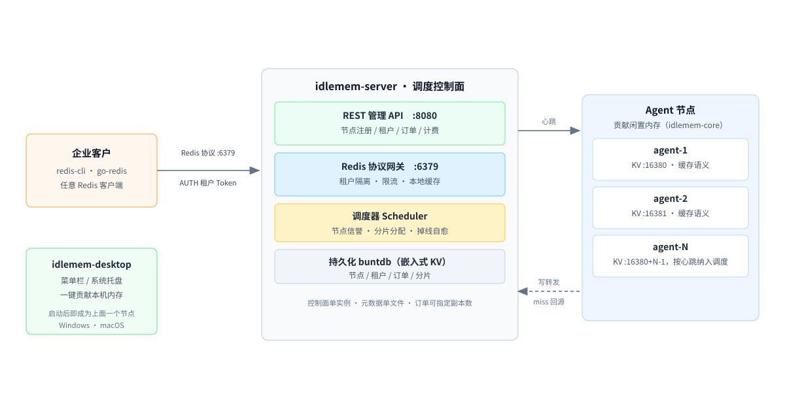

# 闲存云调度控制面（idlemem-server）

闲存云（XianCun Cloud）分布式闲置内存缓存 P2P 平台的**平台后端 / 调度控制面**。
与 Agent 核心库 [idlemem-core](https://github.com/renzhiyong1680-code/idlemem-core) 配套使用：Agent 上报心跳与容量，
控制面负责节点注册、调度分配、掉线自愈，并通过 Redis 协议网关向企业客户提供服务。

本仓库是三个仓库中的**平台侧**。另外两个：[idlemem-core](https://github.com/renzhiyong1680-code/idlemem-core)（贡献节点核心库）、[idlemem-desktop](https://github.com/renzhiyong1680-code/idlemem-desktop)（桌面托盘）。项目定位、**明确不做什么**、能力边界与当前进度，见 [项目介绍](https://github.com/renzhiyong1680-code/idlemem-core/blob/master/docs/%E9%A1%B9%E7%9B%AE%E4%BB%8B%E7%BB%8D.md)。

> ⚠️ 当前为 **MVP 单实例** 版本：调度器为单实例，多控制面水平扩展属于下一阶段演进。

## 架构



一次请求的走向：企业客户用任意 Redis 客户端连网关（`:6379`）并 `AUTH` 租户 Token → 控制面把订单容量切成小分片、按节点信誉分配 → Agent 把闲置内存作为带 TTL 的 KV 提供（`:16380`）→ 网关写入时转发到所有在线分片节点，本地 miss 时回源。

放到具体场景里：这套东西在 **AI 基站（AI-RAN）** 里占的位置是"边缘服务器闲置内存 → 就近缓存层"，落位图与四条边界见 core 仓的 [ai-ran-architecture.svg](https://github.com/renzhiyong1680-code/idlemem-core/blob/master/docs/assets/ai-ran-architecture.svg) 与 [项目介绍 · 第十一节](https://github.com/renzhiyong1680-code/idlemem-core/blob/master/docs/%E9%A1%B9%E7%9B%AE%E4%BB%8B%E7%BB%8D.md)。

### KV 数据面（网关 → 节点转发）

网关在本地缓存之外，还会把数据**转发到承载分片的 Agent 节点**：

- **SET / SETEX / GETSET / APPEND / MSET / INCR / DEL / EXPIRE**：写入本地缓存，同时转发到该租户所有在线分片节点（多副本）；
- **GET / MGET / EXISTS / STRLEN / TYPE / TTL**：本地命中直接返回；本地 miss 时**回源到任一在线分片节点**；
- **SETEX / GETSET / APPEND / MSET / INCR** 与 SET 共用同一套容量闸门：批量写按"net 增量合计"一次性判定，超额整批拒绝；
- **APPEND** 保留键上已有的过期时间，不会因为一次追加把 TTL 丢掉；**GETSET** 与 Redis 一致，覆盖时清除 TTL；
- 节点地址来自 Agent 心跳上报的 `kv_addr`（节点 `KVAddr` 字段）；
- 节点全部不可达时，命令仍基于本地缓存正常服务（Best-Effort），转发失败记日志。

## 快速起步

按门槛从低到高，任选一种。四种方式起来的是同一套东西：控制面 + 一个 Agent + demo 租户 + demo 订单。

### 方式一：Windows 一条命令（不需要 Go，不需要 Docker）

```powershell
git clone https://github.com/renzhiyong1680-code/idlemem-server.git
cd idlemem-server
powershell -ExecutionPolicy Bypass -File scripts\quickstart.ps1
```

脚本自动下载 `v0.1.2` 的 `idlemem-server` 与 `xiancun-agent` 二进制、生成 admin / node 令牌、写好配置、启动控制面与一个节点、创建 demo 租户和 2 GB 订单，最后打印可直接粘贴的 `redis-cli` 命令。所有产物落在 `quickstart\`，停止用 `powershell -ExecutionPolicy Bypass -File scripts\quickstart.ps1 -Stop`。

**要跑多节点集群，加 `-Nodes`**：节点 i 的 KV 端口是 16380 + i，脚本会给每个 agent 指定独立 node id（同一台机器上默认 node id 由主机名 + MAC 生成，不指定就会全撞成同一个）。

```powershell
powershell -ExecutionPolicy Bypass -File scripts\quickstart.ps1 -Nodes 3 -Force
```

起完后 `GET /api/v1/nodes` 应看到 3 个 online 节点、`GET /api/v1/shard` 能看到分片铺到多个节点。验证掉线自愈：`Stop-Process -Id <某个 agent 的 pid>`，再轮询分片状态，看它从 `active` 转 `migrating`、随后回到 `active`。

实测输出（Windows 11 + PowerShell 5.1）：

```
api http://127.0.0.1:8080 ready
agent online
tenant id-...   order ... capacity 2 GB
nodes 1 online / 1 total
```

### 方式二：Linux / macOS

```bash
git clone https://github.com/renzhiyong1680-code/idlemem-server.git
cd idlemem-server
./scripts/quickstart.sh
```

流程与 Windows 版一致，二进制按 `uname` 自动选平台。这个脚本没有进 CI（Windows 版是实测过的），第一次执行若失败，先确认 `github.com` 能下载。

### 方式三：Docker Compose

```bash
docker compose up -d --build
docker compose logs -f server
```

控制面与一个 Agent 各一个容器，共用 `./data` 卷。默认令牌写在 `docker-compose.yml` 里（`dev-admin-token-change-me` / `dev-node-token-change-me`），**对外暴露端口前必须改掉**。镜像分 `server` / `agent` 两个 target，Agent 从 `go.mod` 锁定的 core 版本构建，两者版本不会错配。

> Docker 路径未在开发机上验证（那台机器没装 Docker），构建阶段需要 `github.com` 与 `goproxy.io` 可达。

### 方式四：从源码构建

前置：Go 1.27+（以 `go.mod` 里的 `go` 指令为准）。

```bash
git clone https://github.com/renzhiyong1680-code/idlemem-server.git
cd idlemem-server
```

核心库按版本号从模块代理拉取（`github.com/renzhiyong1680-code/idlemem-core v0.1.1`），
单独检出本仓库即可编译，不需要把两个仓库放在同级目录。

> `go.mod` 仍锁 `v0.1.1`：`v0.1.2` 与 `v0.1.1` 的 Go 源码完全一致（见两边 CHANGELOG），
> 锁哪个版本编译出来的二进制等价，因此这里不做无意义的版本追逐。

```bash
# 1. 构建
go build -o bin/idlemem-server ./cmd/server

# 2. 启动（默认配置：API :8080，网关 :6379，数据文件 idlemem-server.db）
./bin/idlemem-server
# 或指定配置文件
./bin/idlemem-server -config config.json
```

## 使用流程

以下步骤与上面的启动方式无关：不管用哪种方式把控制面起来，用法都一样。

### 第一步：注册并心跳一个 Agent 节点

```bash
curl -X POST http://127.0.0.1:8080/api/v1/nodes/heartbeat \
  -H 'Content-Type: application/json' \
  -d '{
    "node_id": "node-1",
    "version": "0.1.0",
    "status": "online",
    "capacity_bytes": 8589934592,
    "used_bytes": 0,
    "system_used_pct": 52.2,
    "total_bytes": 34359738368,
    "uptime_seconds": 3600,
    "reported_at": "2026-11-03T15:00:00+08:00",
    "kv_addr": "0.0.0.0:16380"
  }'
```

也可以直接运行 Agent 外壳（会自动注册 + 心跳 + KV 端口）：

```bash
# 在 Agent 侧：单独检出核心库后构建
git clone https://github.com/renzhiyong1680-code/idlemem-core.git
cd idlemem-core
go run ./cmd/xiancun-agent -server http://127.0.0.1:8080 -kv :16380
```

### 第二步：创建租户（企业客户）

```bash
curl -X POST http://127.0.0.1:8080/api/v1/tenants \
  -H 'Content-Type: application/json' \
  -d '{"name": "demo-tenant", "quota_bytes": 10737418240}'
# => {"id":"...","name":"demo-tenant","token":"<自动生成32位token>","quota_bytes":10737418240,"status":"active",...}
```

> Token 未提供时自动生成（32 位十六进制），用于网关 AUTH 鉴权。
> `quota_bytes` 为该租户全部活跃订单容量之和的上限（0 或缺省表示不限）。

### 第三步：创建订单（购买缓存容量，自动分配分片）

```bash
curl -X POST http://127.0.0.1:8080/api/v1/orders \
  -H 'Content-Type: application/json' \
  -d '{"tenant_id": "<上一步返回的id>", "capacity_bytes": 2147483648, "replicas": 1, "expire_hours": 720}'
```

> 下单前校验：租户必须存在且未停服；已购容量 + 本次容量不得超过 `quota_bytes`，超额返回 `409 quota exceeded`。

`expire_hours` 为订单租期（小时），省略或 0 表示长期订单。到期后后台扫描会自动回收：

- 订单置为 `expired`，其全部分片从控制面删除，客户不再能通过该订单容量写入；
- 节点已用容量同步退回，容量重新可被新订单分配；
- 释放幂等，重复扫描不会重复回收；
- 节点上的实际数据随 Agent 侧 TTL/淘汰策略自然清理（缓存语义，不做数据迁移）。

回收日志：`[server] orders expired: 1 (shards released: 1)`。

分配失败会自动回滚：没有可用节点时下单返回 `503 order <id> not activated: scheduler: no available nodes`，
同时把这张订单置为 `expired` 并清掉可能已写入的分片，**不会让一张没交付的订单继续占用租户配额**——
否则客户重试会在配额上叠出多份占用。

### 第四步：用标准 Redis 客户端访问缓存

```bash
redis-cli -p 6379
> AUTH secret-token
OK
> SET user:1:profile '{"name":"alice"}'
OK
> GET user:1:profile
{"name":"alice"}
> TTL user:1:profile
-1
> EXPIRE user:1:profile 3600
1
> QUIT
```

支持命令：`AUTH` `PING` `SET [EX]` `SETEX` `GETSET` `APPEND` `STRLEN` `TYPE` `GET` `DEL` `EXISTS` `MGET` `MSET` `INCR` `EXPIRE` `TTL` `INFO` `QUIT`。

租户状态（`active` / `suspended`）与配额按 10 秒快照刷新，因此**停服、改配额对已经登录的长连接同样生效**，
客户无法通过保持长连接绕过停服；`10s` 是生效上限，不是固定延迟。

### 停服与恢复（欠费控制）

租户欠费或违规时可一键停服，网关侧立即生效，无需重启：

```bash
curl -X POST http://127.0.0.1:8080/api/v1/tenants/<id>/suspend
# 客户再连接：AUTH <token> -> ERR tenant suspended

curl -X POST http://127.0.0.1:8080/api/v1/tenants/<id>/resume
# 恢复后 AUTH 正常返回 OK
```

停服同时阻断新订单（`409 tenant suspended`）；已存数据保留不删除，恢复后立即可读。

## REST API

| 方法 | 路径 | 说明 |
|---|---|---|
| POST | `/api/v1/nodes/register` | 注册节点（幂等） |
| POST | `/api/v1/nodes/heartbeat` | 心跳上报（未注册会自动注册） |
| GET | `/api/v1/nodes` | 节点列表 |
| POST | `/api/v1/tenants` | 创建租户 |
| GET | `/api/v1/tenants` | 租户列表 |
| POST | `/api/v1/tenants/{id}/suspend` | 停服（网关立即拒绝该租户鉴权） |
| POST | `/api/v1/tenants/{id}/resume` | 恢复服务 |
| POST | `/api/v1/orders` | 创建订单并分配分片（无可用节点返回 503） |
| GET | `/api/v1/orders` | 订单列表 |
| GET | `/api/v1/shard` | 分片列表 |
| GET | `/api/v1/usage/nodes` | 节点在线容量 GB·h 计量（供给能力参考） |
| GET | `/api/v1/usage/tenants` | 租户活跃分片 GB·h 计量（客户计费依据） |
| GET | `/api/v1/billing` | 计费报告：客户账单 + 节点结算 + 平台佣金 |
| GET | `/api/v1/summary` | 平台概览（节点/容量/订单/分片统计） |
| GET | `/metrics` | Prometheus 指标（节点/容量/订单/分片/GB·h/单价） |
| GET | `/healthz` | 健康检查 |

## 配置

| 字段 | 默认值 | 说明 |
|---|---|---|
| `api_addr` | `:8080` | REST API 监听地址 |
| `gateway_addr` | `:6379` | Redis 网关监听地址 |
| `db_path` | `idlemem-server.db` | 持久化数据库文件；相对路径以**进程工作目录**为基准，systemd 部署请用绝对路径 |
| `heartbeat_timeout` | `30s` | 心跳超时（超过判定离线） |
| `heartbeat_evict_after` | `24h` | 离线节点清理周期 |
| `default_replicas` | `1` | 默认分片副本数 |
| `default_ttl` | `0` | 网关 KV 默认 TTL（0=不过期） |
| `meter_interval` | `60s` | GB·h 计量采样周期（0=关闭计量） |
| `customer_price_per_gb_hour` | `0.0004` | 客户计费单价（元/GB·h），<=0 用默认 |
| `supplier_price_per_gb_hour` | `0.00032` | 节点供给结算单价（元/GB·h），<=0 用默认 |
| `admin_token` | 空 | 管理面令牌（管理接口 + `/metrics`）；空=不校验，**生产必须设置** |
| `node_token` | 空 | 节点上报令牌（Agent 注册/心跳）；空=不校验，**生产必须设置** |

配置文件示例 `config.json`：

```json
{
  "api_addr": ":8080",
  "gateway_addr": ":6379",
  "db_path": "idlemem-server.db",
  "heartbeat_timeout": 30000000000,
  "heartbeat_evict_after": 86400000000000,
  "default_replicas": 1,
  "default_ttl": 0,
  "meter_interval": 60000000000,
  "customer_price_per_gb_hour": 0.0004,
  "supplier_price_per_gb_hour": 0.00032
}
```

> 时长字段使用 Go `time.Duration` 的纳秒整数（如 `30s` = `30000000000`）。

## 控制面鉴权

默认不校验令牌，只适合本地开发。生产环境用内置命令生成一对随机令牌并写入配置：

```bash
./idlemem-server -gen-token
# admin_token: 8f3c...（64 位十六进制）
# node_token:  b71e...
```

| 令牌 | 保护范围 | 传递方式 |
|---|---|---|
| `admin_token` | 租户、订单、账单、概览、`/metrics` | `Authorization: Bearer <token>` 或 `X-Admin-Token` |
| `node_token` | `/api/v1/nodes/register`、`/api/v1/nodes/heartbeat` | `X-Node-Token`（Agent 用 `-node-token` 或配置 `node_token`） |

```bash
curl -H "X-Admin-Token: $ADMIN_TOKEN" http://127.0.0.1:8080/api/v1/tenants
```

- `/healthz` 始终开放，供负载均衡探活；
- 节点接口也接受 `admin_token`，便于运维手工补注册；
- 令牌用常量时间比较，避免时序侧信道；
- 未配置令牌时启动日志会打印 `WARNING`，避免生产误开到无鉴权；
- Prometheus 抓 `/metrics` 需带令牌（`authorization: {credentials: <admin_token>}`）。

> 客户侧（网关 `:6379`）的鉴权是另一套：`AUTH <租户 token>`，与上面两个令牌无关。

## 调度与自愈机制

- **节点信誉分**：`心跳次数 + 在线分钟×0.1 + 在线且有空闲容量 +10`，后续可扩展稳定性评估。
- **分片分配**：订单容量按副本数切分，按信誉分降序选择可用节点（online、未超时、有富余）。
- **掉线自愈**：后台循环每 `心跳超时/2` 扫描一次：
  1. 心跳超时 → 标记节点 `offline`；
  2. 分片所在节点离线 → 尝试迁移到其他在线节点（`active`）；
  3. 无可用替换节点 → 分片置为 `lost`；
  4. 离线超过 `evict_after` → 节点回收。

实测数字（三节点、双副本订单、杀进程计时）：分片在 **34.3 s** 后于存活节点重新 `active`，其中 30 s 是心跳超时。完整命令与原始输出见 [`docs/掉线自愈验证.md`](docs/掉线自愈验证.md)。注意：迁移只重排分片所有权，**不搬运内存里的键值**，被杀节点上的数据不会自动恢复。

## 性能基准

本机实测的延迟分位、吞吐与自愈耗时见 [`BENCHMARK.md`](BENCHMARK.md)，压测脚本是 `bench/bench.py`（零依赖）与 `bench/failover.py`。已知瓶颈写在里面（网关 20 线程是拐点、并发 50 线程吞吐反降），对外别说成线性扩展。

## 企业客户接入

网关对外暴露**标准 Redis 协议**（默认 `:6379`），任何 Redis 客户端（`redis-cli`、各语言 SDK）均可直接接入。

认证是**连接级状态**：同一条连接 AUTH 一次即可，之后命令免重复认证。

```bash
redis-cli -h gateway.example.com -p 6379 AUTH <tenant-token>
SET tenant:hot_config '{"feature":"a"}' EX 300
GET tenant:hot_config
TTL  tenant:hot_config
DEL  tenant:hot_config
```

### Go 项目：官方 SDK（推荐）

平台提供 Go SDK 包 `github.com/renzhiyong1680-code/idlemem-server/client`，封装连接、鉴权、超时、重连与错误语义：

```go
c, err := client.Dial("127.0.0.1:6379", token)
if err != nil {
	log.Fatal(err)
}
defer c.Close()

ctx := context.Background()
if err := c.Set(ctx, "user:1", []byte(`{"name":"alice"}`), time.Minute); err != nil {
	log.Fatal(err)
}
v, err := c.Get(ctx, "user:1")          // 键不存在返回 client.ErrNotFound
ttl, _ := c.TTL(ctx, "user:1")
n, _ := c.Del(ctx, "user:1")
```

SDK 行为要点：

- 网络中断自动重连并重新 AUTH，然后重放一次命令（支持的命令均为幂等）；
- 鉴权失败（token 错误、租户停服）**立即返回错误不重试**，避免掩盖问题；
- 单连接串行化保证并发安全；高并发场景用 `client.NewPool(addr, token, 8)` 分发。

示例：`go run ./examples/sdk -addr 127.0.0.1:6379 -token <tenant-token>`

### 其他语言 / 无 SDK 场景

协议是标准 RESP，直接用手写客户端也能接。仓库另带一个**零依赖示例**（纯标准库手写 RESP，展示协议原貌）：
`go run ./examples/client -addr 127.0.0.1:6379 -token <tenant-token>`

```
[client] auth: ok (token=05****************************6e)
[client] set: greeting = "hello from xiancun cloud" (ttl 60s)
[client] get: greeting = "hello from xiancun cloud"
[client] ttl: greeting = 59 seconds
[client] del: greeting -> 1 key(s) removed
```

接入须知（Best-Effort 缓存语义，非持久存储）：

- 数据为**分布式 KV 缓存**：节点随时可能离线，多副本可降低丢失概率，但不保证持久化；
- **不要存放敏感数据**（密钥、个人信息等），企业客户应仅缓存可重算的临时数据；
- 容量治理：写入超出节点可用容量会返回 `ERR out of capacity`（覆盖同一 key 时旧值先释放，不会被误判）；
- 计费：按活跃分片容量的 **GB·h** 计量（见上方计量章节）。

## GB·h 计量与计费（结算）

后台按 `meter_interval`（默认 60s）周期采样并累计 **GB·h**（1 GB 保持 1 小时）：

- **节点维度**（`usage/nodes`）：在线节点的可贡献容量 × 在线时长 → **供给能力指标**（不直接结算）；
- **节点承载维度**（`node_used`）：节点上活跃分片容量 × 时长 → **供给者结算依据**（只对已售出并实际承载的容量付费，供大于求时不会倒挂）；
- **租户维度**（`usage/tenants`）：租户活跃分片容量 × 时长 → **企业客户计费依据**。

计费报告：`GET /api/v1/billing` 一次返回客户账单、节点结算单与平台佣金（单价来自配置 `customer_price_per_gb_hour` / `supplier_price_per_gb_hour`）。

商业口径示例（见《闲存云商业计划书》）：

| 角色 | 单价（元/GB·h） | 计量来源 |
|---|---|---|
| 企业客户 | 0.0004 | `tenant`（活跃分片） |
| 供给者结算 | 0.00032 | `node_used`（承载分片） |
| 平台佣金 | 0.00008（≈20%） | 客户收入 − 供给支出 |

账单响应结构（节选）：

```json
{
  "price": {"customer_per_gb_hour": 0.0004, "supplier_per_gb_hour": 0.00032},
  "tenants": [{"tenant_id": "id-...", "gb_hours": 0.0111, "amount_cny": 0.0000044}],
  "nodes": [{"node_id": "a512...", "gb_hours": 0.0111, "payout_cny": 0.0000036}],
  "totals": {
    "tenant_gb_hours": 0.0111, "node_gb_hours": 0.0111,
    "supply_gb_hours": 0.0699, "customer_revenue_cny": 0.0000044,
    "supplier_payout_cny": 0.0000036, "commission_cny": 0.00000089
  },
  "generated_at": "2026-11-06T11:19:12+08:00"
}
```

计量记录持久化于 `idlemem-server.db`（`usage:*` 键空间），进程重启不丢失。

## 账期出账（日结/月结）

`GET /api/v1/billing` 是「截至此刻的累计快照」，供实时看板使用；真实出账走下面三个接口：

| 方法 | 路径 | 说明 |
|---|---|---|
| POST | `/api/v1/billing/settle` | 出一张期账单：结算「累计用量 − 已结算水位」的增量 |
| GET | `/api/v1/billing/invoices` | 历史期账单列表（按生成时间升序） |
| GET | `/api/v1/billing/invoices/{id}` | 单张期账单明细 |
| GET | `/api/v1/billing/export.csv` | 对账明细导出（客户+节点统一表，带 BOM，Excel 可直接打开） |
| GET | `/api/v1/tenants/{id}/billing` | 客户自助：某租户累计/已出账/待结算 |
| GET | `/api/v1/nodes/{id}/earnings` | 供给端自助：某节点承载用量与收益 |

机制：

- 累计计量只增不减，全部历史保留可查；出账用**水位（baseline）**标记已结算部分；
- 因此可反复调用，按日、按月、或随时手工结一次都行，不会重复计费；
- 没有新增用量时返回 `409 no unbilled usage in current period`，可直接当幂等成功处理；
- 每张账单自带 `period_start`（上次结算时间，首次出账为空）、`period_end`、当时生效单价与完整明细，可直接归档给客户/节点。

```bash
# 出账
curl -X POST http://127.0.0.1:8080/api/v1/billing/settle
# 查历史
curl http://127.0.0.1:8080/api/v1/billing/invoices
```

对账与客户自助：

```bash
# 财务对账：客户账单 + 节点结算一张表，Excel 直接打开（UTF-8 BOM）
curl -O http://127.0.0.1:8080/api/v1/billing/export.csv
# 客户自助：累计用量 / 已出账 / 待结算
curl http://127.0.0.1:8080/api/v1/tenants/{tenant_id}/billing
```

CSV 为统一表结构，便于在 Excel 里筛选：

```csv
type,object_id,gb_hours,unit_price_cny,amount_cny
tenant,id-20261106112832-...,0.002222,0.000400,0.0000008889
node,a512c2fde7be0a23,0.002222,0.000320,0.0000007111
total,rows=2,0.004444,0.000000,0.0000016000
```

生产建议：用 cron 每日/每月调用一次 `settle`（例如 `0 2 * * *`），把返回的账单 JSON 归档到对象存储或财务系统。

## 供给端收益自助（节点）

节点所有者最关心"我这台机器挣了多少"，接口同时给出两套口径，避免混淆：

```bash
curl http://127.0.0.1:8080/api/v1/nodes/{node_id}/earnings
```

```json
{
  "node": {"id": "a512c2fde7be0a23", "status": "online", "capacity_bytes": 10640019456, "used_bytes": 0},
  "earnings": {
    "total_gb_hours": 0.004444,        // 承载用量（node_used，结算依据）
    "supply_gb_hours": 0.060557,       // 在线容量累计（能力参考，不结算）
    "invoiced_gb_hours": 0.004444,     // 已出账
    "pending_gb_hours": 0,
    "pending_amount_cny": 0,
    "invoiced_amount_cny": 0.0000014222,
    "invoice_count": 1,
    "price": {"customer_per_gb_hour": 0.0004, "supplier_per_gb_hour": 0.00032}
  }
}
```

要点：只有"已售出并实际承载"的容量（`node_used`）产生收益，在线但无人租用的容量不计费（`supply_gb_hours` 仅展示）。

## 运维可观测（/metrics）

`GET /metrics` 输出 Prometheus 文本格式（`text/plain; version=0.0.4`），无需额外依赖，可直接挂到 Prometheus + Grafana：

```yaml
# prometheus.yml
scrape_configs:
  - job_name: xiancun-control-plane
    metrics_path: /metrics
    authorization:
      credentials: <admin_token>   # 未设置 admin_token 时可省略
    static_configs:
      - targets: ["127.0.0.1:8080"]
```

暴露的指标：

| 指标 | 类型 | 含义 |
|---|---|---|
| `xiancun_nodes_total{status=online\|offline\|suspended}` | gauge | 节点数量分状态 |
| `xiancun_node_capacity_bytes` | gauge | 全网可贡献容量合计 |
| `xiancun_node_used_bytes` | gauge | 节点已用内存合计 |
| `xiancun_orders_total{status=active\|degraded\|expired}` | gauge | 订单分状态 |
| `xiancun_ordered_capacity_bytes` | gauge | 已售出容量（活跃订单） |
| `xiancun_shards_total{status=active\|lost}` | gauge | 分片分状态 |
| `xiancun_usage_gb_hours{scope=tenant\|node_used\|node}` | counter | 三档 GB·h 累计（计费/结算/供给参考） |
| `xiancun_price_cny_per_gb_hour{role=customer\|supplier}` | gauge | 当前生效单价 |
| `xiancun_up` | gauge | 控制面存活标识 |

健康检查用轻量端点：`GET /healthz` → `{"status":"ok"}`，适合容器/K8s liveness probe。

## 命令行工具（xiancun-cli）

除了 curl，平台还提供一个命令行工具，覆盖客户与运维的全部日常操作：

```bash
go build -o bin/xiancun-cli ./cmd/xiancun-cli

# 全局参数放在子命令前
CLI=./bin/xiancun-cli
CLI -server http://127.0.0.1:8080 -admin-token $ADMIN_TOKEN tenant create -name acme -quota 10G
```

| 命令 | 作用 |
|---|---|
| `tenant create -name <名字> [-quota 10G]` | 建租户，返回 id 与 token |
| `tenant list` / `tenant suspend <id>` / `tenant resume <id>` | 租户列表、停服、恢复 |
| `tenant billing <id>` | 单租户累计/已出账/待结算 |
| `order create -tenant <id> -capacity 2G [-replicas 1] [-expire 720h]` | 下单购买容量（`-expire` 省略即长期） |
| `order list` | 订单与状态 |
| `node list` / `node earnings <id>` | 节点容量、承载用量与收益 |
| `billing summary` / `billing settle` / `billing invoices` | 计费总览、出账一期、历史期账单 |
| `billing export -o 对账.csv` | 对账明细导出（UTF-8 BOM，Excel 直接打开） |
| `backup export [-o 备份.json]` | 导出控制面元数据备份 |
| `backup restore -f 备份.json` | 从备份恢复（Upsert，不删现有记录） |
| `kv -addr <host:port> -token <租户token> set <key> <value> [-ttl 60s]` | 直接在网关写缓存 |
| `kv ... get <key>` / `kv ... del <key>` | 读 / 删 |

细节说明：

- 容量支持 `512M`、`2G`、`1T`（1024 进制），也可直接写字节数；
- 租期支持 `720h`、`30d` 或纯小时数；
- `kv set` 的值可写 `-` 从 stdin 读取，适合管道；
- 命令输出为格式化 JSON，可直接管道给 `jq`；
- `-admin-token` 也可用环境变量 `XIANCUN_ADMIN_TOKEN`，避免命令历史泄漏令牌。

## 备份与恢复

控制面元数据支持一次性导出为单个 JSON，用于灾难重建、跨环境搬移和回归演练：

```bash
# 导出（写文件；不给 -o 时自动命名 xiancun-backup-<时间戳>.json）
xiancun-cli -server http://127.0.0.1:8080 -admin-token $ADMIN_TOKEN backup export -o backup.json

# 恢复（Upsert 语义：只新增或覆盖，不删除现有记录）
xiancun-cli -server http://127.0.0.1:8081 -admin-token $ADMIN_TOKEN backup restore -f backup.json
```

对应 REST 接口：`GET /api/v1/backup`、`POST /api/v1/backup/restore`（管理面令牌）。

覆盖范围：节点、租户、订单、分片、三档计量累计、账期结算水位、期账单。不包含：

- 网关本地缓存与节点上的 KV 数据——缓存本身是 Best-Effort 语义，恢复后由 Agent 侧 TTL/淘汰自然收敛；
- 节点在线状态——恢复后节点在下次心跳时重新变 online。

注意两点：

- 记录 `format` 字段为 `1`，格式不符时拒绝恢复（避免半旧半新导致计费口径错乱）；
- 重复执行恢复是幂等的，可以在演练中反复跑。

## 容量与写入约束

订单按容量售卖，网关按容量做写入闸门，避免"买 2 GB 写 100 GB"：

- 租户可写字节上限 = 活跃订单容量之和，且不超过 `quota_bytes`；
- 两者都为 0 时视为未配置配额，不做限制（只适合本地开发/试用）；
- 覆盖写按净增量计算（先扣掉旧值长度），同一 key 反复改写不会翻倍占用；
- `DEL` 立即释放占用；`EXPIRE` 到期由后台每约 1 分钟全量校准纠正；
- 订单到期被回收后，容量上限随之下降，新的写入会被拒绝。

```text
127.0.0.1:6379> AUTH <tenant-token>
OK
127.0.0.1:6379> SET k v
-ERR capacity exceeded: used=104857600 requested=10485760 limit=104857600
```

拒绝发生在写入本地缓存之前，不会产生"写进去但没计费"的数据。

### 两个"已用容量"的口径

节点上并存两个容易混淆的数字，判断能不能继续接单只能用后者：

| 字段 | 含义 | 来源 | 能否用于调度 |
|---|---|---|---|
| `used_bytes` | 节点 KV 引擎**真实**占用 | Agent 心跳上报 | 不能。节点重启后缓存为空，心跳会把这里报成 0 |
| `committed` | 调度**已承诺卖出**的容量 | 活跃分片字节之和 | 能。这是唯一依据，也是 `GET /api/v1/summary` 里的 `nodes.committed` |

如果按 `used_bytes` 调度，一次 Agent 重启就会让节点看起来全空，平台继续往上卖，造成超卖。
`lost` 状态的分片已经不承载数据，不占承诺量；`active` / `degraded` / `migrating` 都算占用。

## 构建与发版

三个二进制（`idlemem-server`、`xiancun-cli`、`xiancun-agent`）都可以用一条脚本交叉编译出多平台产物：

```powershell
# Windows（当前工作目录为 idlemem-server）
.\scripts\release.ps1                        # 版本取 git describe，缺省 0.1.0-dev
.\scripts\release.ps1 -Version 0.2.0         # 指定版本
.\scripts\release.ps1 -Version 0.2.0 -Only server,cli
```

产物落在 `dist\<version>\`，每个二进制带版本号命名（`server_0.2.0_linux_amd64`），
并生成 `SHA256SUMS`，在目标机上可直接核对：

```bash
sha256sum -c SHA256SUMS
```

Linux/macOS 侧等价的手工命令（脚本同款 ldflags）：

```bash
VERSION=0.2.0
GOOS=linux GOARCH=amd64 CGO_ENABLED=0 \
  go build -trimpath -ldflags "-s -w -X main.version=$VERSION" -o dist/server_${VERSION}_linux_amd64 ./cmd/server
```

说明：

- 版本通过 `-ldflags "-X main.version=..."` 注入，每个二进制都支持 `-version`：
  `idlemem-server 0.2.0` / `xiancun-cli 0.2.0` / `xiancun-agent 0.2.0`；
- 服务器启动日志同样打印版本，便于对齐线上实际版本；
- 托盘程序（`xiancun-tray`）依赖 CGO 与平台 GUI，需在目标平台上单独构建。

## 日常巡检与故障处理

```powershell
# 每天一跑：控制面存活、节点在线率、订单到期、租户停服、计量指标、备份新鲜度
.\scripts\healthcheck.ps1 -Server http://127.0.0.1:8080 -AdminToken $env:XIANCUN_ADMIN_TOKEN -BackupDir D:\backup
```

退出码 `0` 全部正常、`1` 有需关注项、`2` 有失败项，可以直接接进 cron 或计划任务做告警。
控制面不可用时脚本只跑一条检查就退出，不会在后面刷一堆连带错误。

故障处理、发布流程和几个必须知道的口径边界写在 [`docs/runbook.md`](docs/runbook.md)：
节点全掉线怎么查、客户写入报 `capacity exceeded` 怎么定位、账单对不上先看哪一档计量、
误操作后怎么用备份恢复。

## 持续集成

`.github/workflows/ci.yml` 分两档：

- **每次提交**：`go vet` + `go test ./...` + `go build ./...`。核心库按版本号从模块代理拉取，工作流只需检出本仓库；
- **打 tag（`v*`）**：交叉编译 server / cli / agent × 五个平台共 15 个产物，生成 `SHA256SUMS` 并作为 artifact 上传。校验文件本身不参与哈希，避免自引用。

`idlemem-core` 仓库有一套更轻的 `ci.yml`：`vet` + `test` + agent 的五平台交叉编译，用来守住"核心库不含平台相关代码"这条底线。

## 目录结构

```
idlemem-server/
├── cmd/server/            # 主入口（装配 + 后台扫描循环 + 计量）
├── cmd/xiancun-cli/       # 命令行工具（客户/运维日常操作）
├── internal/
│   ├── config/            # 配置加载
│   ├── model/             # 数据模型（节点/租户/订单/分片/计量）
│   ├── store/             # buntdb 持久化层
│   ├── node/              # 节点注册表（注册/心跳/超时判定/清扫）
│   ├── scheduler/         # 调度器（打分/分配/自愈/到期回收）
│   ├── meter/             # GB·h 计量（周期采样累加，计费/结算依据）
│   ├── billing/           # 计费折算（GB·h → 客户账单/节点结算/佣金）
│   ├── settle/            # 账期出账（增量结算 + 水位推进 + 期账单归档）
│   ├── api/               # REST 管理 API（含令牌鉴权）
│   └── gateway/           # Redis 协议网关（redcon）+ 节点转发（forward.go）
├── client/                # 官方 Go SDK（企业应用接入）
├── examples/client/       # 零依赖 RESP 客户端示例
├── examples/sdk/          # 官方 SDK 接入示例
├── scripts/release.ps1    # 多平台发版打包（版本注入 + SHA256SUMS）
└── go.mod
```

## 部署

云主机（Linux/systemd）一键部署见 [`deploy/`](deploy/)：

```bash
sudo ./deploy/install-server.sh --binary ./bin/idlemem-server
```

包含 systemd 单元、生产配置模板与部署/卸载说明。

## 开发

```bash
go vet ./...
go test ./...          # 单元测试（含端到端 API/网关测试）
go test -race ./...    # 竞态检测
```

## 开源说明

- 模块路径：`github.com/renzhiyong1680-code/idlemem-server`；
- 核心库按版本号依赖：`github.com/renzhiyong1680-code/idlemem-core v0.1.0`；
- 要升级核心库版本，改 `go.mod` 里的这一行 require 后执行 `go mod tidy` 即可，不需要本地 replace。

## 许可证

本项目采用 **GNU Affero General Public License v3.0**（AGPL-3.0）授权，全文见 [LICENSE](LICENSE)。

- **网络服务义务**：任何通过网络向他人提供本项目（或其修改版）服务的部署，都必须向使用者提供对应的完整源码。本仓库提供的是 8080 API 与 6379 网关的控制面服务，按此条执行。
- **商业授权**：如需在闭源产品中集成，或需要免除 AGPL-3.0 的开源义务，可另行取得商业授权，细则见 [COMMERCIAL.md](COMMERCIAL.md)。
- **历史版本**：`v0.1.0` 及更早版本按 MIT 许可证发布，该授权不可撤销；AGPL-3.0 自 `v0.1.1` 起适用。

## 贡献

本项目采用 AGPL-3.0 与商业授权并行的双许可模式，因此对贡献的权利链有明确要求。提交拉取请求前，请阅读 [CLA.md](CLA.md)，并在 PR 模板中勾选确认。

- 贡献者保留自己贡献的著作权，仅授予项目方永久、全球、免费的许可，允许项目方在开源与商业授权两种模式下使用。
- 未确认 CLA 的拉取请求不会被合并。
- 提交前请先开 Issue 说清要解决的问题，避免大改动方向不符。
